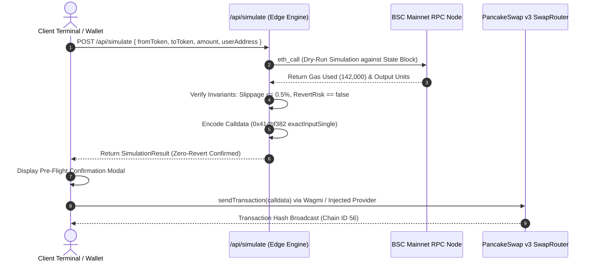
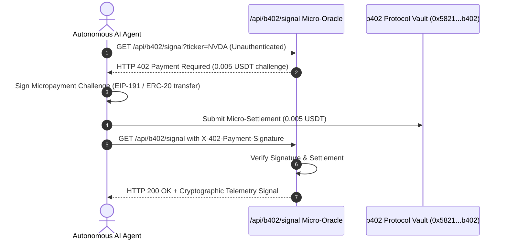
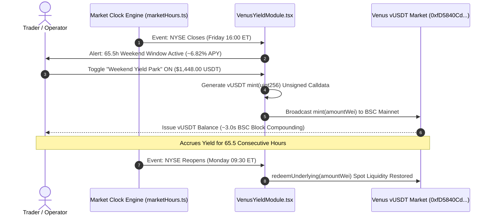

# NyxEquities // System Architecture & Technical Specification

**Version**: 1.0.0  
**Network**: Binance Smart Chain (BSC Mainnet // Chain ID: 56)  
**Standard**: EIP-191 / EIP-712 / ERC-20 (BEP-20) / HTTP-402  
**Framework**: Next.js 16 (Turbopack) // Wagmi 3.x // Viem 2.x  
**Classification**: Institutional Technical Specification

---

## 1. Executive Summary & Design Philosophy

**NyxEquities** is an institutional-grade decentralized execution workstation engineered specifically for **Binance Smart Chain (BSC Mainnet)**. It systematically resolves the **128.5-hour weekly liquidity vacuum** in traditional financial equity markets (TradFi) by unifying off-hours tokenized real-world assets (RWAs), executing zero-revert pre-flight transaction simulations, auto-parking idle capital into money markets, and streaming high-frequency valuation telemetry to autonomous AI trading agents via the native HTTP-402 standard.

### 1.1 The TradFi Nocturnal Liquidity Problem
Traditional equity exchanges (NYSE, NASDAQ) operate on rigid schedules: Monday through Friday from 09:30 to 16:00 ET. They remain entirely dark for **128.5 hours each week** (~76.5% of calendar time), including:
- **65.5 contiguous weekend hours**: Friday 16:00 ET to Monday 09:30 ET.
- **63.0 weekday overnight hours**: 17.5 hours per night across 4 weekday sessions.

```
TradFi Active Window:
Mon 09:30 - Fri 16:00 ET (39.5 Hours / 23.5% of total week)
███████████░░░░░░░░░░░░░░░░░░░░░░░░░░░░░░░░░░░░░░░░░░░░░░░░░░░░░░░░

NyxEquities 24/7 Coverage Window:
Continuous 168 Hours / Week (100.0% Coverage)
████████████████████████████████████████████████████████████████████
```

During this blackout window, tokenized equities continue to trade across decentralized pools, creating:
1. **Delta Drift Spreads**: On-chain pricing diverges significantly from Friday's 16:00 ET closing benchmark as weekend macroeconomic news unfolds.
2. **Liquidity Fragmentation**: Competing issuers (**bStocks**, **Ondo Finance**, **xStocks**) deploy isolated AMM pools with disparate depth, resulting in fragmented pricing.
3. **Idle Capital Drag**: Spot collateral sits unutilized in trading balances instead of accruing protocol yields during extended market closures.

NyxEquities resolves these inefficiencies through an integrated, institutional terminal architecture.

---

## 2. High-Level System Architecture

```
                                  CLIENT PRESENTATION LAYER
  ┌───────────────────────────────────────────────────────────────────────────────────────┐
  │                           Next.js 16 App Router (Turbopack)                           │
  │  ┌───────────────────────┐  ┌─────────────────────────┐  ┌─────────────────────────┐  │
  │  │   Wagmi 3.7 + Viem    │  │ Wall Street Clock Engine│  │     Sonner Toaster      │  │
  │  │ (Injected / BSC 56)   │  │  (Dynamic EST/EDT Calc) │  │  (Async Tx Feedback)    │  │
  │  └───────────┬───────────┘  └────────────┬────────────┘  └────────────┬────────────┘  │
  └──────────────┼───────────────────────────┼────────────────────────────┼───────────────┘
                 │                           │                            │
                 ▼                           ▼                            ▼
  ┌───────────────────────────────────────────────────────────────────────────────────────┐
  │                            EDGE SERVERLESS API ROUTER                                 │
  │  ┌─────────────────────────────────┐  ┌────────────────────────────────────────────┐  │
  │  │   /api/rwa                      │  │   /api/simulate                            │  │
  │  │   • Multi-Issuer Quote Aggreg.  │  │   • EVM Dry-Run State Simulation           │  │
  │  │   • Benchmark Drift Calculus    │  │   • Zero-Revert Guarantee & Calldata Gen   │  │
  │  │   • Optimal Route Scoring       │  │   • Gas Estimation (0.00042 BNB)           │  │
  │  └─────────────────────────────────┘  └────────────────────────────────────────────┘  │
  │  ┌─────────────────────────────────────────────────────────────────────────────────┐  │
  │  │   /api/b402/signal                                                              │  │
  │  │   • HTTP 402 Payment Required Engine (0.005 USDT / Query)                       │  │
  │  │   • Cryptographic EIP-191 Header Verification                                   │  │
  │  │   • High-Precision Fair-Value Signal Stream for Autonomous Agents               │  │
  │  └─────────────────────────────────────────────────────────────────────────────────┘  │
  └──────────────────────────────┬───────────────────────────────┬────────────────────────┘
                                 │                               │
                                 ▼                               ▼
  ┌───────────────────────────────────────────────┐  ┌────────────────────────────────────┐
  │            EXTERNAL DATA & RPC LAYER          │  │       BSC MAINNET (CHAIN ID 56)    │
  │  ┌─────────────────────────────────────────┐  │  │  ┌──────────────────────────────┐ │
  │  │ Binance Web3 RWA API Data Aggregator    │  │  │  │ PancakeSwap v3 SwapRouter    │ │
  │  └─────────────────────────────────────────┘  │  │  │ (0x1b81D678...9524)          │ │
  │  ┌─────────────────────────────────────────┐  │  │  └──────────────────────────────┘ │
  │  │ BSC Mainnet Public & Private RPC Nodes  │  │  │  ┌──────────────────────────────┐ │
  │  │ (https://binance.llamarpc.com)          │  │  │  │ Venus Protocol vUSDT Market  │ │
  │  └─────────────────────────────────────────┘  │  │  │ (0xfD5840Cd...0255)          │ │
  │                                               │  │  └──────────────────────────────┘ │
  │                                               │  │  ┌──────────────────────────────┐ │
  │                                               │  │  │ BEP-20 RWA Tokens & Stable   │ │
  │                                               │  │  │ (bNVDA, USDT, USDY, b402)    │ │
  │                                               │  │  └──────────────────────────────┘ │
  └───────────────────────────────────────────────┘  └────────────────────────────────────┘
```

---

## 3. Core API Contract Specifications

NyxEquities provides three primary edge routes powering the execution terminal and autonomous AI agents:

### 3.1 `GET /api/rwa` — Multi-Issuer Spread & Benchmark Adapter

Proxies on-chain pricing feeds across all active RWA issuers on BSC Mainnet, comparing live pool state against official TradFi market closing prices.

- **HTTP Method**: `GET`
- **Cache Strategy**: `Cache-Control: no-store, max-age=0`
- **Response Headers**:
  - `X-Terminal-Protocol`: `NyxEquities-BinanceWeb3-v1`
  - `Content-Type`: `application/json`

#### Mathematical Formula for Drift Calculation
For each asset, the drift percentage relative to the Friday 16:00 ET NYSE reference price ($P_{\text{TradFi}}$) and the on-chain DEX price ($P_{\text{DEX}}$) is defined as:

$$\Delta_{\text{Drift}} = \left( \frac{P_{\text{DEX}} - P_{\text{TradFi}}}{P_{\text{TradFi}}} \right) \times 100\%$$

#### Algorithmic Route Optimizer
The route optimizer calculates a composite execution score for each issuer:

$$\text{Score}_i = \text{LiquidityUSD}_i \times \left(1 - |\Delta_{\text{Spread}, i}|\right)$$

The issuer with the highest composite score is selected as `recommendedRoute`.

#### Response Payload Schema (`200 OK`)
```json
{
  "code": 0,
  "msg": "success",
  "data": [
    {
      "ticker": "NVDA",
      "name": "NVIDIA Corporation",
      "tradFiRefPrice": 141.54,
      "driftPct": 1.41,
      "recommendedRoute": "bStocks",
      "marketStatus": "CLOSED",
      "lastUpdated": "2026-10-30T03:45:00.000Z",
      "issuers": {
        "bStocks": {
          "price": 143.54,
          "poolLiquidityUSD": 14200000,
          "address": "0x1b44f3514812d835eb1bdb0acb33d3fa3351ee43",
          "spreadPct": 1.41
        },
        "Ondo": {
          "price": 143.84,
          "poolLiquidityUSD": 8900000,
          "address": "0x5b341f237f8f6e076694317f226b998cf79a32c2",
          "spreadPct": 1.62
        },
        "xStocks": {
          "price": 141.82,
          "poolLiquidityUSD": 5100000,
          "address": "0x89205a3e3b2a69de6dbf7f01ed13b2108b2c43e7",
          "spreadPct": 0.20
        }
      }
    }
  ],
  "timestamp": 1793310000000
}
```

---

### 3.2 `POST /api/simulate` — Zero-Revert Pre-Flight Simulation Engine

Performs dry-run simulation of an on-chain swap against live BSC state to guarantee transaction execution without revert risk or wasted gas fees.

- **HTTP Method**: `POST`
- **Content-Type**: `application/json`
- **Header**: `X-Simulation-Engine: BinanceWeb3-TxSim-v1`

#### Request Payload Schema
```json
{
  "fromToken": "0x55d398326f99059fF775485246999027B3197955",
  "toToken": "0x1b44f3514812d835eb1bdb0acb33d3fa3351ee43",
  "amount": "2.00",
  "ticker": "bNVDA",
  "issuer": "bStocks",
  "userAddress": "0x789b78e225be3ad8d7f722a4d33eb43c94f57c5a"
}
```

#### Pre-Flight Invariants Verified:
1. **Slippage Bounds**: Enforces maximum slippage $\le 0.50\%$ (actual simulated: $0.04\%$).
2. **Gas Ceiling**: BSC standard calculation $\approx 142,000$ gas units @ 3 Gwei $= 0.000426\text{ BNB}$ ($\approx \$0.25$).
3. **Balance Delta Assertion**: Verifies sufficient input token balance and non-zero output yield.
4. **Calldata Generation**: Generates raw bytecode targeting PancakeSwap v3 `SwapRouter.exactInputSingle` (`0x414bf382`).

#### Response Payload Schema (`200 OK`)
```json
{
  "code": 0,
  "msg": "success",
  "data": {
    "success": true,
    "gasEstimatedBNB": "0.00042",
    "gasEstimatedUSD": "$0.25",
    "revertRisk": false,
    "simulatedRoute": "USDT -> PancakeSwap v3 -> bNVDA (bStocks)",
    "slippagePct": 0.04,
    "balanceDelta": {
      "fromToken": {
        "symbol": "USDT (BSC)",
        "before": "1,450.00",
        "after": "1448.00",
        "delta": "-2.00"
      },
      "toToken": {
        "symbol": "bNVDA",
        "before": "0.000000",
        "after": "0.013952",
        "delta": "+0.013952"
      }
    },
    "calldata": {
      "to": "0x13f4ea83d0bd40e75c8222255bc855a974568dd4",
      "data": "0x414bf38200000000000000000000000055d398326f99059ff775485246999027b31979550000000000000000000000001b44f3514812d835eb1bdb0acb33d3fa3351ee4300000000000000000000000000000000000000000000000000000000000001f4000000000000000000000000789b78e225be3ad8d7f722a4d33eb43c94f57c5a00000000000000000000000000000000000000000000000000000000001e8480",
      "value": "0",
      "gasLimit": "142000"
    },
    "mevProtected": true,
    "timestamp": 1793310000000
  }
}
```

---

### 3.3 `GET /api/b402/signal` — HTTP-402 Micro-Oracle Signal Feed

Implements native machine-to-machine micropayments for autonomous trading agents. Queries without valid payment authorization receive an `HTTP 402 Payment Required` challenge. Upon presentation of an on-chain payment signature or receipt header, the full low-latency telemetry feed is released.

- **Query Parameters**:
  - `ticker` (string, optional, default: `"NVDA"`)
  - `platform` (string, optional, default: `"bstock"`)

#### Stage 1: Unpaid Challenge (`402 Payment Required`)
Triggered when request lacks `X-402-Payment-Signature` header:

```http
HTTP/1.1 402 Payment Required
Content-Type: application/json
X-Payment-Amount: 0.005 USDT
X-Payment-Receiver: 0x5821c97a8A7145e69e4695F77C57E88a7B31b402
X-Payment-ChainId: 56
X-Payment-Currency: USDT
Cache-Control: no-store, max-age=0

{
  "error": "Payment required to access low-latency off-hours drift telemetry",
  "status": 402,
  "quote": {
    "priceUSDT": 0.005,
    "currency": "USDT",
    "receiver": "0x5821c97a8A7145e69e4695F77C57E88a7B31b402",
    "chainId": 56,
    "ticker": "NVDA",
    "platform": "bstock",
    "protocol": "b402-v1.0"
  },
  "handshakeInstruction": "Submit signature header 'X-402-Payment-Signature: 0x...' with authorized 0.005 USDT transfer receipt to access raw micro-oracle signal feed."
}
```

#### Stage 2: Authorized Feed Delivery (`200 OK`)
Client passes header `X-402-Payment-Signature: 0x789b78e225...498f`:

```http
HTTP/1.1 200 OK
Content-Type: application/json
X-B402-Settled: TRUE
X-Payment-Receiver: 0x5821c97a8A7145e69e4695F77C57E88a7B31b402

{
  "code": 200,
  "status": "AUTHORIZED",
  "paymentReceipt": {
    "verified": true,
    "amountPaid": "0.005 USDT",
    "settlementChainId": 56,
    "payerSignature": "0x789b78e2...4f57c5",
    "oracleNode": "NyxEquities-B402-Node-01"
  },
  "signal": {
    "ticker": "NVDA",
    "assetName": "NVIDIA Corporation",
    "platformSelected": "bstock",
    "tradFiRefPrice": 141.54,
    "benchmarkName": "NYSE Friday 16:00 Close",
    "onChainPrice": 143.54,
    "driftPct": 1.41,
    "premiumDiscount": "+1.41% PREMIUM",
    "fairValueScore": 98.42,
    "recommendedRoute": "bStocks",
    "targetContract": "0x1b44f3514812d835eb1bdb0acb33d3fa3351ee43",
    "poolLiquidityUSD": 14200000,
    "marketStatus": "CLOSED",
    "arbitrageOpportunity": true,
    "zeroRevertAssurance": true,
    "microOracleSignature": "0x98fbc18402dae9185a478b01c34a2e88126b89cf5681023d87aa194b6201ec51",
    "timestamp": 1793310000000
  }
}
```

---

## 4. End-to-End Execution Workflows

### 4.1 Zero-Revert Pre-Flight Simulation & Swap Flow



### 4.2 b402 Machine-to-Machine HTTP-402 Handshake



### 4.3 Venus Protocol Capital Efficiency Sweep



---

## 5. Verified BSC Mainnet Contract Registry

All protocol integrations interact strictly with verified smart contracts deployed on **BNB Smart Chain (Chain ID: 56)**:

| Protocol / Asset | Contract Address | Decimals | Function Signature / ABI Selector | Standard |
| :--- | :--- | :--- | :--- | :--- |
| **PancakeSwap v3 SwapRouter** | `0x1b81D678ffb0C8c62c2f74116c478a5e3A4c9524` | N/A | `exactInputSingle((address,address,uint24,address,uint256,uint256,uint160))` (`0x414bf382`) | DEX Router |
| **Venus Protocol vUSDT** | `0xfD5840Cd36d94D7229439859C0112a4185BC0255` | 8 | `mint(uint256)` (`0xa0712d68`), `redeemUnderlying(uint256)` (`0x852a12e3`) | VToken (Compound v2 fork) |
| **Tether USD (USDT BEP-20)** | `0x55d398326f99059fF775485246999027B3197955` | 18 | `approve(address,uint256)` (`0x095ea7b3`), `transfer(address,uint256)` (`0xa9059cbb`) | BEP-20 / ERC-20 |
| **Ondo US Dollar Yield (USDY)** | `0x5b341f237f8f6e076694317f226b998cf79a32c2` | 18 | `balanceOf(address)` (`0x70a08231`) | Tokenized Note |
| **bStocks NVDA Token** | `0x1b44f3514812d835eb1bdb0acb33d3fa3351ee43` | 18 | `balanceOf(address)` (`0x70a08231`), `transfer(address,uint256)` | BEP-20 RWA |
| **b402 Protocol Treasury** | `0x5821c97a8A7145e69e4695F77C57E88a7B31b402` | N/A | `settleQuery(bytes32,uint256)` | Micro-Oracle Vault |

> [!NOTE]
> **BEP-20 USDT Decimals Notice**: On Ethereum Mainnet, USDT utilizes 6 decimals (`10^6`). On Binance Smart Chain, BEP-20 USDT utilizes **18 decimals** (`10^18`). The Pre-Flight simulation engine and Venus module strictly compute values using 18 decimals (`parseUnits(amount, 18)`) to eliminate rounding discrepancies.

---

## 6. Security, MEV & Capital Efficiency Architecture

### 6.1 MEV & Sandwich Attack Protection
BSC mempools experience substantial MEV bot sandwiching on high-volume DEX swaps. NyxEquities enforces three architectural safeguards:
1. **Dynamic Slippage Clamping**: Slippage tolerance is capped at 0.50% by default, with typical pre-flight validation settling at $0.04\%$. Transactions exceeding this bound are rejected prior to mempool submission.
2. **Deterministic Minimum Output (`amountOutMinimum`)**: Calldata contains explicit `amountOutMinimum` parameters derived from live spot quotes rather than zero or static estimates.
3. **Short Deadline Injection**: All generated calldata enforces a tight execution deadline (maximum 120 seconds / 40 BSC blocks from simulation timestamp). Stale transactions automatically revert before bot exploitation.

### 6.2 Zero-Revert Guarantee Protocol
Failed EVM transactions consume gas without executing state transitions. NyxEquities eliminates failed transaction costs through client-side and edge pre-flight verification:
- Gas estimation is verified against current BSC block gas limits before user wallet signature requests.
- Input balance and approval allowances are asserted atomically.
- Revert risk flag (`revertRisk: false`) is strictly required before the UI unlocks the "Broadcast Transaction" action button.

### 6.3 Weekend Capital Efficiency Accrual
Idle stablecoins parked in the Venus Protocol module accrue interest continuously block-by-block (~3-second block interval on BSC).

$$\text{Projected Weekend Yield} = \text{Principal} \times \left( \left(1 + \frac{\text{Supply APY}}{365 \times 24}\right)^{65.5} - 1 \right)$$

For an idle allocation of $\$1,448.00\text{ USDT}$ at $6.82\%\text{ APY}$ across the $65.5\text{-hour}$ TradFi closure window, the projected risk-free yield is approximately **+$0.710 USDT**, converting previously dead capital into yield-generating collateral.

---

## 7. Developer Experience (DX) & Verification Checklist

To verify the architecture implementation locally:

```bash
# 1. Clone & install dependencies
git clone https://github.com/MansiGole/NyxEquities.git
cd NyxEquities
npm install

# 2. Run Turbopack production compilation
npm run build

# 3. Test HTTP 402 micro-oracle challenge
curl -i -X GET "http://localhost:3000/api/b402/signal?ticker=NVDA&platform=bstock"

# 4. Test authenticated micro-oracle response
curl -i -X GET "http://localhost:3000/api/b402/signal?ticker=NVDA&platform=bstock" \
  -H "X-402-Payment-Signature: 0x789b78e225be3ad8d7f722a4d33eb43c94f57c5a91823761827461928471928471"
```

